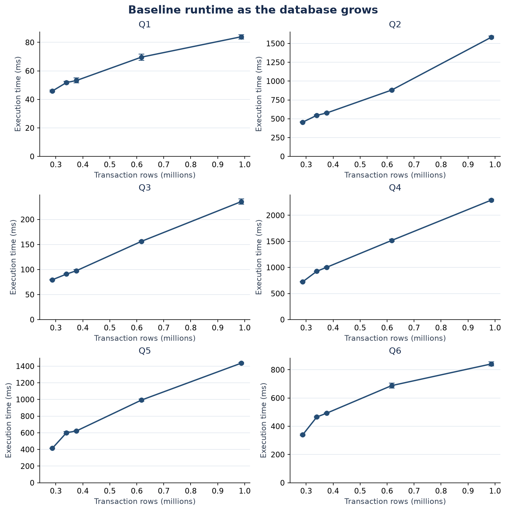
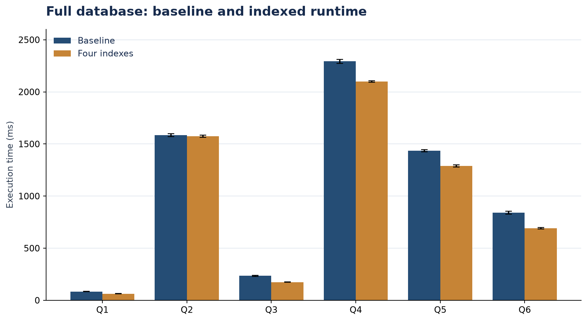

# SD6103 Group Assignment — Assignment 1

Python and PostgreSQL code, query outputs, and measured performance results for the HDB resale and hawker-centre database assignment.

The recorded experiment used PostgreSQL 18.4 on Windows and **986,771 resale transactions across seven stored tables**. It includes **200 measured query executions**: 150 baseline runs at five database sizes, 20 runs testing indexes individually, and 30 runs with all four indexes. Source snapshots were acquired on 17 September 2026, Singapore time.

## Repository contents

| Location | Contents |
|---|---|
| [code/](code/) | Source download, data preparation, benchmark, independent validation, and plotting scripts |
| [sql/01_Create_Database.sql](sql/01_Create_Database.sql) | Database, seven tables, constraints, functions, and views |
| [sql/02_Load_Data.sql](sql/02_Load_Data.sql) | Optional full-database CSV loader for psql |
| [sql/03_Queries.sql](sql/03_Queries.sql) | Queries Q1–Q6; Q6 joins all seven stored tables |
| [sql/04_Create_Indexes.sql](sql/04_Create_Indexes.sql) | Four performance indexes |
| [sql/05_Validate_Schema.sql](sql/05_Validate_Schema.sql) | Checks for an empty schema; fixtures are rolled back |
| [results/queries/](results/queries/) | Complete outputs at all five sizes and after indexing |
| [results/plans/](results/plans/) | EXPLAIN ANALYZE JSON plans and buffer statistics |
| [results/](results/) | Individual timings, summaries, environment, and validation evidence |
| [results/data_quality/](results/data_quality/) | Geocode matching audits and transformation findings |
| [results/source_manifest.json](results/source_manifest.json) | Original source URLs, snapshot dates, row counts, and SHA-256 hashes |
| [results/load_plan.json](results/load_plan.json) | Recorded five-stage loading order and table counts |
| [results/query_preview/](results/query_preview/) | HTML previews of the query results; download to view locally |
| [report_figures/](report_figures/) | Query screenshots and performance plots |
| [Performance_Measurements.xlsx](Performance_Measurements.xlsx) | All 200 observations, formula-based summaries, and seven editable charts |

The written report, assignment brief, lectures, raw datasets, prepared database CSVs, credentials, and software binaries are not included. The `report_figures/` name is retained because the plotting script writes its outputs there.

## View the recorded results

Open the workbook or browse the [full-database query outputs](results/queries/stage_5/). The [independent validation evidence](results/independent_validation.json) records successful checks for all six queries and identical baseline/indexed outputs.





The plotted metric is PostgreSQL's EXPLAIN ANALYZE server Execution Time, in milliseconds. Each query has one warmup and five measured repetitions. Error bars show the sample standard deviation. These are warm-cache, single-client observations; timings depend on hardware and server settings.

Q1 uses the fixed period 1997–1999. Q5 uses an average-price threshold of SGD 250,000. Distance classes are NEAR below 500 m, MEDIUM from 500 m to below 1,000 m, and FAR at least 1,000 m. Missing geocodes remain unknown. A flat identifier represents an observed attribute profile rather than a uniquely identified physical dwelling.

## Setup

Use Python 3.12 or later. Run commands from the repository root. The examples below use PowerShell.

```powershell
python -m venv .venv
.\.venv\Scripts\Activate.ps1
python -m pip install -r requirements.txt
```

To regenerate the two performance plots from the committed measurements, no database or source data is needed:

```powershell
python code/plot_results.py
```

## Run a new experiment

Use a separate working copy for a new run. First rename its `results/` directory to `results_recorded/` to preserve the supplied evidence. This must happen **before** data preparation and benchmarking. The benchmark scripts refuse to overwrite existing measurement CSVs.

Obtain `hawker_geo.csv` from the course materials. Replace the example path below with its actual location. The downloader requires internet access and `curl` on PATH; it obtains the other seven source files from the public URLs recorded in the code.

```powershell
Rename-Item -LiteralPath results -NewName results_recorded
python code/download_data.py --hawker-geo "C:\path\to\hawker_geo.csv"
python code/prepare_data.py
```

The downloader creates `data/raw/` and a source manifest. Preparation verifies those hashes, creates seven CSV tables and a loading plan under `data/prepared/`, and writes the matching audit to `results/data_quality/`. Both data directories are ignored by Git.

Fresh downloads may differ from the September 2026 snapshots, so their counts and outputs may differ from the committed results. Exact reproduction requires the original eight CSV files with hashes matching `results_recorded/source_manifest.json`; place those files and a copy of that manifest named `sources.json` in `data/raw/` before running preparation. The manifest alone does not contain the data.

Start PostgreSQL and use a role with permission to create a database. PostgreSQL 18.4 was used for the recorded measurements. Supply your own connection details; use a PostgreSQL password file or set `PGPASSWORD` privately if needed.

```powershell
$env:PGDSN = "host=127.0.0.1 port=5432 user=postgres dbname=postgres"
python code/run_experiment.py --database sd6103_repeat
python code/benchmark_indexes.py --database sd6103_repeat
python code/validate_results.py
python code/plot_results.py
```

The runner creates a new database, applies the schema, incrementally loads five sizes, and records 150 baseline measurements. It refuses to reuse an existing database name. Do not run the standalone SQL creation or full-load script before this runner. The index script tests each candidate alone, then all four together. Validation independently recalculates the final query outputs from the prepared CSVs using pandas.

The benchmark sets work memory to 32 MiB and disables JIT and parallel query workers. The recorded server used 128 MiB shared buffers. Avoid concurrent database activity when measuring. Full environment details are in [results/environment.json](results/environment.json).

The committed workbook summarizes the recorded experiment. It is not regenerated by these scripts. For another experiment with the same 200-row layout, replace its Measurements table while preserving column order to update its formulas and charts.

## Load the database without benchmarking

After preparing the data, the following is an alternative to the experiment runner:

```powershell
psql -U postgres -d postgres -f sql/01_Create_Database.sql
psql -U postgres -d sd6103_hdb_hawker -f sql/02_Load_Data.sql
psql -U postgres -d sd6103_hdb_hawker -f sql/03_Queries.sql
psql -U postgres -d sd6103_hdb_hawker -f sql/04_Create_Indexes.sql
```

Creation fails if the database already exists, and the loader expects empty tables. The setup and load files contain psql backslash commands. For pgAdmin, create the database separately, reconnect, and execute the schema's BEGIN-to-COMMIT section; the Python runner provides an alternative COPY interface.

Run the optional `05_Validate_Schema.sql` only against a separate empty schema created with the same DDL, before loading data. It checks 16 behaviours and 24 expected rejections, then rolls back its fixtures.
